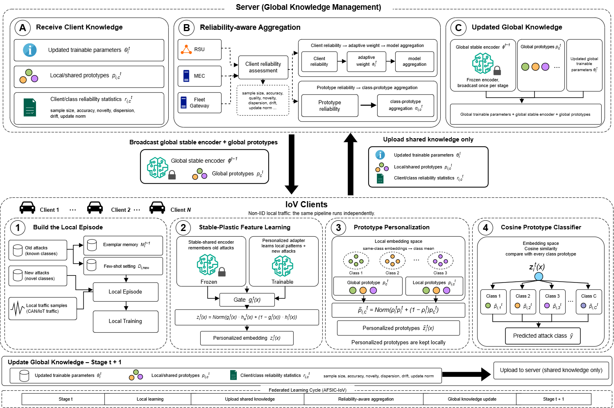

# AFSIC-IoV: Adaptive Personalized Federated Few-Shot Class-Incremental Learning for IoV Intrusion Detection

AFSIC-IoV là hệ thống phát hiện xâm nhập (IDS) cho Internet of Vehicles, kết hợp học liên kết cá nhân hóa (PFL) với học tiệm tiến theo lớp ít mẫu (FSCIL). Nhiều client IoV (RSU, server MEC, cổng kết nối đội xe) cùng học trên dữ liệu bản tin CAN mà không chia sẻ dữ liệu thô, trong điều kiện:

- dữ liệu không đồng nhất (lệch nhãn) giữa các client,
- lớp tấn công mới xuất hiện theo thời gian (5 giai đoạn, 13 lớp, chia `[3, 3, 3, 2, 2]`),
- lớp mới chỉ có ít mẫu có nhãn (kịch bản 10-shot và 1%),
- client tham gia không liên tục (50, 60, 70, 80, 100 client ở năm giai đoạn).



## Thành phần chính

| Thành phần | Mô tả | Vị trí trong code |
|---|---|---|
| Encoder dùng chung | CNN 1D, 31 đặc trưng vào, 64 chiều ra. Được huấn luyện tiếp ở mọi giai đoạn và tổng hợp tại server | `convs/cnn1d.py`, `utils/inc_net.py` |
| Adapter và fusion gate | Adapter nút cổ chai (b = 64, 6.208 tham số) và gate theo từng chiều (8.256 tham số), khởi tạo bằng 0 đầu mỗi giai đoạn, giữ riêng tại client, không tổng hợp | `utils/inc_net.py` |
| Prototype cá nhân hóa | Trộn prototype cục bộ và toàn cục theo tỉ lệ số mẫu của client | `models/afsic_ids.py` |
| Bộ phân loại cosine | So sánh biểu diễn với prototype cá nhân hóa, hệ số tỉ lệ γ = 16 | `models/afsic_ids.py` |
| Hàm mất mát cục bộ | Cross-entropy điều chỉnh logit theo tần suất lớp toàn cục (Menon và cộng sự, 2021) cộng KD, FSP, căn chỉnh prototype, regularization thưa và proximal | `trainer.py`, `losses/` |
| Tổng hợp theo độ tin cậy | Trọng số client theo điểm chất lượng, prototype toàn cục theo độ tin cậy từng cặp (client, lớp) | `utils/aggregation.py`, `trainer.py` |
| Hiệu chỉnh quyết định | Client gửi số đếm ma trận nhầm lẫn cho 27 giá trị τ, server chọn τ* cho F1-macro cao nhất, không dùng tập kiểm thử | `trainer.py` (`_client_tau_selection`, `_decision_calibration`) |
| Replay memory | Herding, 1% số mẫu mỗi lớp, giữ tại client | `utils/memory.py` |

Hai tùy chọn bổ sung, mặc định tắt:

- `quality_gated_update`: server chỉ nhận mô hình vừa tổng hợp nếu F1-macro trên dữ liệu client không thấp hơn mức tốt nhất đã đạt trong giai đoạn, nếu thấp hơn thì giữ mô hình tốt nhất cho vòng sau.
- `calib_fewshot_ratio_scale`: ở kịch bản tỉ lệ (kshot < 1, ví dụ 1%), khi chọn τ*, số đếm của các lớp tiệm tiến được nhân 1/kshot.

## Dữ liệu

Đặt tại `data/` (chạy trên Kaggle thì code tự tìm trong `/kaggle/input`):

```
data/
├── federated_data/client_{c}_task_{t}.pt   # t = 1..5, dict {"x": (N, 31) float16, "y": (N,) int64}
├── global_test_data.pt                     # tập kiểm thử chung
├── class_mapping.json                      # 13 lớp: Benign, DoS, double, force-neutral, ...
└── task_mapping.json                       # nhóm lớp theo 5 giai đoạn
```

Client không tham gia giai đoạn `t` thì không có file `client_{c}_task_{t}.pt` và được bỏ qua ở giai đoạn đó.

## Chạy

Cấu hình duy nhất là `configs/exps/exp_logit_prior.json` (kịch bản dữ liệu đầy đủ, `la_tau = 1`).

```bash
# Chạy từ đầu
python main.py --config configs/exps/exp_logit_prior.json

# Chạy tiếp từ checkpoint cuối một giai đoạn
python main.py --config <config>.json \
    --resume <run_dir>/checkpoints/ckpt_task03_memory_client99.pth \
    --resume_memory <run_dir>/checkpoints/ckpt_task03_memory_client99_MEM.pth
```

Kịch bản ít mẫu được bật trong config: `fewshot_enabled = true` cùng `kshot = 10` (10-shot) hoặc `kshot = 0.01` (1%).

Trên Kaggle dùng `cell_exp.py`. Đặt `SCENARIO`, `LA_TAU`, `QUALITY_GATE`, `RATIO_SCALE`, `RESUME` ở đầu cell. Cell tự tạo config theo kịch bản, dừng trước giới hạn 12 giờ và nén kết quả cùng checkpoint cuối giai đoạn để chạy tiếp ở phiên sau.

## Tái lập kết quả trong bài báo

Kết quả được chạy qua nhiều phiên Kaggle, mỗi phiên chạy tiếp từ checkpoint cuối giai đoạn của phiên trước. Tag `ket-qua-bai-bao` trỏ tới commit đã tạo ra kết quả.

| Phần | Kịch bản | Thiết lập | Chạy từ |
|---|---|---|---|
| Giai đoạn 1 (dùng chung) | đầy đủ | `LA_TAU = 1.0` | đầu |
| Giai đoạn 2 đến 5 | đầy đủ, 10-shot | `LA_TAU = 0.5` | checkpoint sau giai đoạn 1 |
| Giai đoạn 2 | 1% | `LA_TAU = 0.5` | checkpoint sau giai đoạn 1 |
| Giai đoạn 3 đến 5 | 1% | `LA_TAU = 0.5`, `RATIO_SCALE = True` | checkpoint sau giai đoạn 2 |
| Giai đoạn 5 | đầy đủ, 10-shot | `LA_TAU = 0.5`, `QUALITY_GATE = True` | checkpoint sau giai đoạn 4 |

Kết quả trên CAN tại vòng 30 của giai đoạn cuối, mô hình toàn cục sau hiệu chỉnh quyết định (đơn vị %):

| Kịch bản | Accuracy | F1-macro | F1-weighted | Recall-macro |
|---|---|---|---|---|
| Đầy đủ | 93,11 | 20,93 | 95,93 | 31,55 |
| 1% | 83,33 | 18,19 | 90,38 | 40,54 |
| 10-shot | 85,62 | 22,78 | 91,81 | 41,06 |

## Kết quả đầu ra

Mỗi lần chạy ghi vào `logs/afsic-iov_federated/can_iov/<thời gian>_seed42_cnn1d_clients100/`:

- `metrics_round_by_round.csv`: kết quả sau hiệu chỉnh τ* theo từng vòng (accuracy, precision, recall, F1 micro/macro/weighted, cột `tau_star`, `model_round`),
- `metrics_round_by_round_raw.csv`: kết quả trước hiệu chỉnh,
- `calibration.csv`, `calibration_by_round.csv`: τ* được chọn và F1 trên dữ liệu client cho từng giá trị τ,
- `confusion_matrix_task_XX.csv` và `confusion_matrix_task_XX_calib.csv`: ma trận nhầm lẫn trước và sau hiệu chỉnh,
- `checkpoints/ckpt_taskXX_memory_client99.pth` và `_MEM.pth`: checkpoint cuối giai đoạn để chạy tiếp,
- `training.log`.

## Cấu hình chính

| Key | Giá trị | Ý nghĩa |
|---|---|---|
| `num_clients`, `num_rounds`, `local_epochs` | 100, 30, 1 | số client, số vòng mỗi giai đoạn, số epoch cục bộ mỗi vòng |
| `batch_size`, `lr`, `weight_decay` | 8192, 3e-5, 2e-4 | tham số tối ưu |
| `local_loss_mode`, `la_tau` | `logit_adjusted`, 1.0 | cross-entropy điều chỉnh logit và hệ số τ (0,5 ở giai đoạn tiệm tiến) |
| `decision_calibration`, `calib_every_n_rounds` | true, 1 | bật hiệu chỉnh τ* và chọn lại ở mỗi vòng |
| `aggregate_encoder_only` | true | chỉ tổng hợp encoder, adapter và gate giữ tại client |
| `adapter_bottleneck`, `adapter_identity_init` | 64, true | kích thước ẩn của adapter, lớp cuối adapter và gate khởi tạo bằng 0 |
| `proto_q_mode` | `class_recall` | độ tin cậy prototype dùng recall từng lớp đo tại client |
| `memory_ratio` | 0.01 | kích thước replay memory theo tỉ lệ số mẫu |
| `fewshot_enabled`, `kshot` | false, 10 | kịch bản ít mẫu |
| `quality_gated_update` | false | cập nhật toàn cục có kiểm định |
| `calib_fewshot_ratio_scale` | false | nhân 1/kshot số đếm lớp tiệm tiến khi chọn τ* ở kịch bản tỉ lệ |

## Cấu trúc thư mục

```
main.py                 # điểm vào, đọc config và gọi trainer
trainer.py              # vòng lặp học liên kết, tổng hợp, hiệu chỉnh τ*, ghi kết quả
cell_exp.py             # cell Kaggle
configs/exps/exp_logit_prior.json
models/                 # AFSIC-IoV (afsic_iov.py kế thừa afsic_ids.py)
convs/                  # backbone CNN 1D
losses/                 # KD, FSP, prototype, regularization
utils/                  # dữ liệu, mạng, tổng hợp, replay memory
docs/figures/           # hình kiến trúc
```

## Tag

| Tag | Nội dung |
|---|---|
| `ket-qua-bai-bao` | commit đã tạo ra kết quả trong bài báo |
| `ban-cu-truoc-logit-prior` | bản code trước khi dùng hàm mất mát điều chỉnh logit |
| `luu/doi-chung`, `luu/fedlc`, `luu/fedrs`, `luu/q-cai-thien` | các thí nghiệm phụ đã kết thúc |
